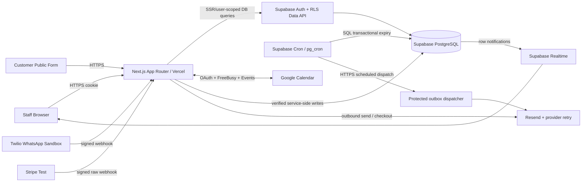

# Architecture — Next.js + Supabase, Secure Modular Monolith

## Deployment and trust boundaries

**Two Supabase client boundaries:** (1) `createServerClient` from `@supabase/ssr` carries the logged-in user's session and exercises RLS; (2) a carefully restricted **server-only** service client for signed webhooks/cron/controlled onboarding. Never pass the service key to client JavaScript; do not run admin client calls directly based on user-supplied IDs.

## Feature module boundaries
`src/features/{identity,workspaces,permissions,crm,leads,communications,payments,calendar,notifications,integrations,audit,reporting}` each own `server/`, `schemas.ts`, `types.ts`, `components/` as needed. UI route names stay in `src/app/(app)/...`; provider endpoints in `src/app/api/webhooks/...`. `src/lib/supabase/{client,server,admin}.ts`, `src/contracts`, `supabase/migrations`, `supabase/tests`, `supabase/seed.sql` are shared.

## Request types
- **User read:** Next.js RSC/Route Handler resolves authenticated user with current Supabase Auth identity, verified membership/permission; use user-scoped client & RLS. Sensitive value data comes from a permission-safe server projection/RPC, not a `select('*')` response.
- **User mutation:** Next.js Server Action or Route Handler verifies user + membership + permission + Zod payload; calls an RLS-constrained mutation or a **narrow, audited DB function** for multirow transactions, returns typed error (401/403/404/409/422).
- **Anonymous public intake:** Next.js applies strict rate limit/honeypot/CAPTCHA policy and `workspaceSlug` validation, passes only validated public fields to a fixed-purpose server function. Direct anonymous inserts into CRM tables are forbidden.
- **Provider webhook:** Next.js Route Handler reads **raw body**, resolves integration endpoint identifier, verifies provider signature with tenant-specific secret, checks replay uniqueness, then uses a narrowly scoped service operation to store event and mutate tenant state. Never trust `workspaceId` from the payload.
- **Cron expiry:** authenticated Supabase Cron executes fixed SQL function in `private` schema at chosen cadence; row locks + database time + unique attempt key settle races and commit an outbox event.

## Multi-tenant isolation
Each tenant record has `workspace_id`; use composite same-workspace foreign keys plus RLS on every exposed row. Permission predicates check `(auth.uid(),workspace_id,action)` via locked-down functions in non-exposed `private` schema. `service_role` bypasses RLS, which is why any elevated path must derive workspace from verified provider endpoint/auth record and explicitly scope every SQL operation. A Manager is a configurable permission preset; Owner/Admin/User are base levels.

## Lead correctness over design illusions
Persistent record fields: `owner_user_id NOT NULL`, `assigned_at`, `deadline_at`, `first_assigned_at`, `first_acknowledged_at`, `version`, `escalation_count`, `current_level`. In one database transaction: lock record; validate availability/capacity; choose owner; update version; append assignment and audit; insert outbox. On deadline, a scheduled batch locks due leads (`FOR UPDATE SKIP LOCKED`), skips acknowledged/changed versions, escalates at most once and commits; retries are safe. Browser countdown is only a projection of `deadline_at`.

## Durable external effects and monitoring
`outbox_events` stores committed intentions. A protected scheduled dispatch processes unhandled rows, calls Resend (or needed provider), records attempts and visible errors, retries with bounded exponential backoff and quarantines permanently failing events. Outbound provider traffic is **never** inside a DB transaction. Provider inbound event log uses unique `(provider,integration_id,provider_event_id)` and signed requests.

## Realtime rules
Subscribe only to authorized workspace data; avoid publishing sensitive payloads to broad channels. For a newly arrived event, invalidate the corresponding query and re-fetch through RLS. Authenticate subscriptions and verify publication policies. A fallback periodic query (15–30s) is fine for a demo but not a substitute for Q11. Reconnect queries DB state; realtime notification ordering is not authoritative.

## Architecture tradeoffs
- **Benefits:** one repo/deployment for web and server handlers, managed DB, built-in auth/realtime, no standalone Redis/worker to babysit during judging.
- **Caveats:** serverless request limits and background processing: **never rely on persistent Next.js processes**; schedule via Supabase Cron, not `setInterval`/in-memory timers.
- **Secret management:** OAuth refresh tokens and provider keys server-only encrypted (KMS / envelope key) and never in Data API-accessible row projections.
- **Conflicts:** Postgres row locks and version checks handle concurrency; provider eventual consistency must be reflected with `pending/syncing/failed` UI states.

## Decision records
ADR-01 Next.js single deploy; ADR-02 Supabase Auth+RLS; ADR-03 SQL functions for atomic transitions; ADR-04 DB Cron + transactional outbox; ADR-05 verified provider webhooks; ADR-06 static UI prototype is not implementation.
