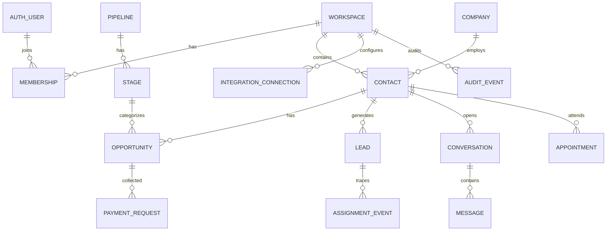

# Data Model, Schema Owners and Consistency Constraints — Supabase PostgreSQL

## Scope and model decisions
Use SQL migrations (`supabase/migrations/*.sql`) with Postgres UUID keys, `timestamptz`, composite `(workspace_id,id)` references, typed states/check constraints, UTC deadlines and `jsonb` custom values. `auth.users` holds identities, **not** a custom password table. Source requirements F2.3 explicitly require **two** pipelines with different custom fields despite “one customizable pipeline” in short scope; support multiple pipeline rows and one default per workspace.

## Core entities (essential columns only)
| Entity | Tenant/security and important fields | Ownership |
|---|---|---|
| `profiles` | `id` FK `auth.users.id`; display name, avatar, timezone | A |
| `workspaces` | `id, slug, name, owner_user_id, created_at` | A |
| `memberships` | `workspace_id,user_id,base_role,availability,enabled` | A |
| `permission_roles`, `role_grants` | tenant role & permission set, member binding | A |
| `companies` | `id,workspace_id,name,version,archived_at` | C migration request → A |
| `contacts` | `id,workspace_id,company_id,name,email,phone_e164,owner_user_id,version,archived_at` | C → A |
| `pipelines` | `id,workspace_id,name,is_default` | C → A |
| `stages` | `id,workspace_id,pipeline_id,name,position,terminal_type,archived_at` | C → A |
| `opportunities` | `id,workspace_id,contact_id,pipeline_id,stage_id,value_minor,currency,owner_user_id,custom_values jsonb,version,archived_at` | C → A |
| `field_definitions` | `id,workspace_id,pipeline_id,entity_type,key,type,options jsonb,archived_at` | C → A |
| `stage_required_fields` | `workspace_id,stage_id,field_definition_id` | C → A |
| `saved_views` | `id,workspace_id,owner_user_id,entity_type,filter_ast jsonb,columns jsonb` | C → A |
| `leads` | `id,workspace_id,contact_id,source,source_ref,owner_user_id NOT NULL,assigned_at,first_assigned_at,first_acknowledged_at,deadline_at,last_action_at,current_level,escalation_count,version,status` | A |
| `assignment_rules` | `workspace_id,max_open_leads,rotation_cursor,levels jsonb,backup_user_id,manager_user_id,idle_seconds` | A |
| `lead_assignment_events` | `id,workspace_id,lead_id,from_user_id,to_user_id,cause,due_at,previous_version,created_at` | A |
| `conversations`,`messages` | channel, contact, owner, Twilio SID, status, attempt/error fields | C → A |
| `payment_requests`, `refunds` | provider refs, amounts in minor currency units, event status, confirmed/refunded | C → A |
| `appointments` | contact/opportunity/employee, Google event ID, starts_at/ends_at UTC, timezone, status | C → A |
| `integration_connections` | server-only encrypted credentials, endpoint_id, status | A/C |
| `integration_events` | provider, external event ID, result, failure, attempts, last success | A/C |
| `audit_events` | actor, action, entity, before/after safe data; append-only | A |
| `outbox_events` | event type, payload safe metadata, idempotency key, retries, next_attempt_at | A |

## Required constraints and indexes
- PK UUIDs, unique `(workspace_id,id)` on tenant entities, matching composite FKs for same-workspace relationships, no cascade delete on financial/audit data.
- `(workspace_id, source, source_ref)` unique where source_ref nonnull; `(integration_id,provider_event_id)` unique on webhook events; `(lead_id,previous_version,cause)` unique to prevent repeat transitions.
- `leads.owner_user_id NOT NULL` and FK ensuring owner is same-workspace enabled member. Provide workspace Owner emergency fallback when no eligible available rep; flag exceptional routing.
- `contacts (workspace_id,phone_e164)` partial unique for nonnull normalized phone; phone matching must not cross workspace.
- Index `(workspace_id, deadline_at) where first_acknowledged_at is null` and `(workspace_id,owner_user_id,status)`, plus tenant CRM board/search/access indexes.
- `version` increments with changed high-contention rows; optimistic mutation checks `expectedVersion` and returns conflict, not last-write-wins.
- Monetary values use integer minor units; collected total = verified paid amount minus **confirmed** refunds; never derive it from projected opportunity values.

## Security exposure & sensitive values
Separate `private.integration_credentials` from public metadata; no grants to `anon` or `authenticated`. Similarly, `opportunity_value_private` or another restricted read model prevents accessing amounts through raw Data API queries without proper permission. The `opportunities` client-facing projection omits restricted fields by design. Financial rollups must also be scoped and permission-gated to avoid inferential leakage. Use security-invoker views when exposed; audit views and reporting endpoints require role checks.

## Atomic multirow operations
`private.create_workspace_for_authenticated_user`, `private.capture_lead`, `private.acknowledge_lead`, `private.reassign_lead`, `private.escalate_due_leads`, `private.move_opportunity_stage`, `private.ingest_verified_provider_event` are **design contracts**: write secure SQL functions or equivalent explicit Postgres transactions. Internal `private.*` functions are not directly exposed in PostgREST; call through secured server database connection / carefully designed exposed wrappers with authenticated identity, never through arbitrary elevated generic RPC.

## Database migrations
Single owner A controls numbered timestamp SQL migrations, with SQL lint and `supabase db reset` on **local** database before merging. C supplies reviewed migration requests/SQL patch to A. RLS, grants, indexes and test fixtures enter in same PR as each table. Track compatible additive changes first; avoid production-destructive reset.
