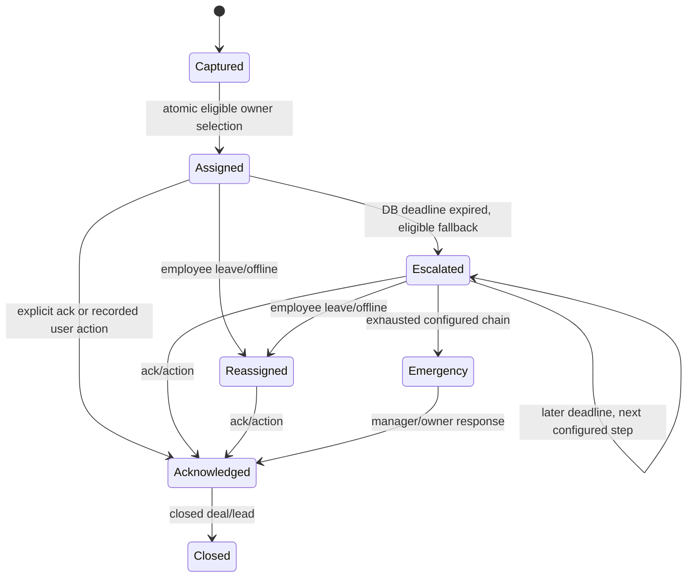

# Lead Ownership, Acknowledgement and Escalation — Formal Engine Spec

## Non-negotiable invariant
**Exactly one accountable owner per open lead at every committed DB state.** The owner is always an enabled same-workspace member; when nobody available, send to configured Owner emergency coverage and mark queue risk. Available-only restriction applies to normal employee candidate selection. Unacknowledged leads must escalate; acknowledging prevents pending expiry.

## Sources, transitions, priority
Manual, public web form, verified Twilio incoming message all enter `capture_lead(source)` transaction. Lead state dimensions: `open/closed` × `unacknowledged/acknowledged` × `level` (primary 0, alternate primary 1..N, backup N+1, manager N+2, emergency Owner). Audit each assignment, acknowledgement, status change and escalation. Distinguish manual reassignment from automatic escalation in activity/metrics.

## Assignment algorithm
In a single Postgres transaction acquire per-workspace routing cursor row lock; query **Available** and enabled memberships with open assigned lead count below cap. Sort stable member order, choose next round-robin after cursor, set owner/deadline/version, create lead assignment history and audit/outbox. If none eligible, choose Owner emergency as designated fallback and flag recovery reason `NO_ELIGIBLE_EMPLOYEE`. Never insert null owner. F3.4 assigns a configurable number of seconds to each level; avoid client-specified free-form deadlines.

## Acknowledge semantics
Valid explicit button or action (note/message/call log/stage change/appointment) is recorded. Set `first_acknowledged_at` **only once**, based on DB time, and record actor. If ack arrives simultaneously with expiry, row lock winner decides: after escalation, former owner gets 409 owner-changed and may not acknowledge on previous assignment. Initial response time = `first_acknowledged_at - first_assigned_at` as source defines. An acknowledged lead does not auto-rotate just because its past expiry timer fires.

## Cron scheduler and crash recovery
Supabase Cron can schedule SQL jobs (including sub-minute cadence, subject to project capability/observed behavior). `private.escalate_due_leads(limit)` obtains due unacknowledged rows ordered by deadline using `FOR UPDATE SKIP LOCKED`; in one transaction for each row, check current owner/version/deadline, select eligible next-level owner with capacity, update owner/level/count/deadline/version, write unique `(lead_id, previous_version, 'timeout')` event, audit and outbox. Return status counts for observability; if no other candidate, emergency Owner gets flagged. Cron's persisted schedule and state survive Next.js serverless restarts. Claim **near-deadline**, not exact 1-second trigger until measurement verifies it.

## Leave/offline
Employee status set to On leave or Offline triggers immediate DB transaction to reassign all **unacknowledged** leads (batch safely if large); already acknowledged leads stay assigned unless configured manager reassigns them manually, and the interface displays this policy. Race with acknowledgement must not duplicate transition. Busy is ineligible for *new* normal assignment, but does not automatically strip existing ownership.

## Recovery reasons (can coexist)
`PAST_DUE_UNACKNOWLEDGED`, `ESCALATED_TWICE`, `IDLE_TOO_LONG`, `NO_ELIGIBLE_EMPLOYEE`, `FAILED_EXTERNAL_ALERT`. Recovery entry has actionable owner, due/age and explanation. Recompute from source-of-truth fields rather than drifting boolean flags; record archived recovery resolutions in activity. At-risk countdown is descriptive, not a mutation trigger.

## Outbox notification
Each committed `lead.escalated` event inserts an immutable outbound email intent for **new owner**, with source, reason and link; a separate dispatcher sends via Resend, bounded retries and visible failures. Do not call Resend within Postgres transaction or on every expired scan replay.

## Test matrix
- 100 concurrent intakes with eligible user capacities; no over-allocation beyond configured max for normal assignment.
- 2 cron invocations racing same expired lead → one assignment event and one version change.
- Acknowledge vs expiry two orders → exactly one logical winner, same owner rules.
- Supabase/Next.js process restart after a due deadline → next Cron run recovers.
- Duplicate incoming Twilio webhook creates one lead.
- On leave while unacknowledged → immediate transfer; acknowledged case stays and is visible.
- Backup and manager fallbacks, exhausted chain and Owner emergency handling.
- No unlocked or null-owner intermediate persisted state; every event has actor or system.
- 2-workspace routing and email recipient isolation.
