# MASTER: Full End-to-End Implementation Plan — Next.js + Supabase

**Execution standard:** Not a checklist of pages. Each session names branch, responsible developer, dependency, exact implementation, test proof, handoff and merge gate. One session is a focused work block. Hackathon duration was not supplied, so do NOT interpret sessions as hours or days. Sessions may overlap when assigned to different developers and dependencies are merged.

## Team lanes
- **A — architecture, DB, authentication, security and lead engine:** single owner for SQL migrations + RLS, scheduler, transactions and deployment.
- **B — premium UI/UX and frontend integration:** design tokens, React App Shell, responsive screens, client interactions, E2E accessibility.
- **C — CRM domain and four provider integrations:** requests DB changes from A, builds feature server modules, provider workflows and API tests.

3 laptops → 3 long-lived dev branches / short PRs, distinct working trees. For 2 developers: A absorbs provider integration server tasks; B takes CRM forms/field editor plus rest of UI. No solo developer is assigned two concurrent coding tasks. **No one except A merges SQL migrations or contracts without written review.**

## Step 0: prerequisites and accounts (S00 — ALL, BEFORE coding)
**Requires:** problem statement. **Branch:** none. **Work:** agree product name/theme (proposed RelayHQ), select review lead A, select demo workspace/business example, specify primary demo zone/currency, allocate provider test credentials, Google OAuth consent users, Twilio sandbox join phone, Resend verified sender, Vercel + Supabase dev/demo projects, HTTPS domain, local Docker or shared development instance. Agree session duration and real competition cutoff, establish risk register and one source-of-truth issue board. **Gate:** confirm provider access early; mark unverified external providers as blockers.

## Wave 1 — design and foundation (S01–S04; 3 parallel tracks after S01)
### S01 — Interface architecture and contract freeze (ALL, 1 joint session)
**Branch:** `chore/contract-foundation` owned A; B/C review. **Build:** screen sitemap, semantic palette typography and components from `02–04`, route names, DTO/permission strings in `src/contracts`, SQL table ownership, business glossary/metrics, `/api/v1` response envelopes, design screenshots as definition-of-done. **Gate:** signed contracts tag `foundation-contract-v1`; no simultaneous schema modifications.

### S02 — Next.js + Supabase bootstrap (A; starts after S01)
**Branch:** `feat/bootstrap-supabase`. **Implement:** create-next-app TypeScript App Router, Supabase CLI dev project, migration runner, SSR cookie clients browser/server, `admin.ts` restricted, Auth callback, project env sample and `.gitignore`, CI lint/type/test, error envelope, setup docs and seed script. **Test:** fresh machine from README, user signs in across reload, env secrets absent from client bundle. **Merge gate:** mandatory before any server/domain PR. **Critical.**

### S03 — visual shell + component kit (B; parallel S02 and S04)
**Branch:** `feat/ui-foundation`. **Implement:** `globals.css` tokens, font setup, accessible shadcn Button/Dialog/Sheet/Table, sidebar/topbar/global search, responsive navigation, statuses, skeletons, theme screen references; basic Dashboard, Recovery, Pipeline static-but-realistic fixture views. **Tests:** Playwright 1440x900, 768x1024, 390x844, focus/tab/a11y, no clipped controls. **Gate:** visuals match screenshot reference; no fixture status presented as live integration.

### S04 — CRM schema & domain contracts (C design with A migration owner; parallel S02/S03 after S01)
**Branch:** `feat/crm-contracts`. **Implement:** TypeScript Zod domain schemas/DTOs, CRUD rules, stage/field metadata shapes, saved filter AST, test fixtures and proposed SQL migration file **without merging overlapping SQL**. A cherry-picks/reviews migration after S02 and adds RLS tests. **Gate:** board and contact list DTOs immutable after merge; S06 may now start.

## Wave 2 — identity + data spine (S05–S08)
### S05 — multi-tenant Auth/RLS/roles (A; after S02, parallel B S03 and C S06 contract prep)
**Branch:** `feat/identity-rls`. **Implement:** `auth.users` profile link, workspace bootstrap transaction, Owner/Admin/User membership, invitations, permissions and Manager preset, availability field, all RLS grants/read/write tests, opportunity money private-read pattern, authenticated API guards. **Tests:** A/B tenant cross-ID, 403/404, direct Supabase Data API, role changes, logout/session cookie, value export. **Gate:** all tests; no CRM live write before RLS.

### S06 — CRM base CRUD (C; after S05 tables/RLS merged, while B builds UI and A starts S07)
**Branch:** `feat/crm-core`. **Implement:** companies/contacts/opportunities repository + server validation, linked records, soft delete, optimistic version, notes timeline, paginated search and tenant scope. **Test:** CRUD, 500-record list, cross-tenant relationship invalid, 409 stale version, field-level money denial. **Handoff:** stable server contract for B screens. **Merge:** after A migration PR merges.

### S07 — lead intake & round-robin assignment (A; after S05 + contact minimum from S06)
**Branch:** `feat/lead-capture`. **Implement:** public form/manual intake, canonical lead+assignment history, availability, capacity counts, cursor lock, initial deadline, owner emergency fallback, audit/outbox; acknowledge action. **Test:** concurrent intake, all levels unavailable, unauth form throttling, RLS, ack first-response clock. **Demo gate:** public lead → exact one owner → ack → audit; owner persists after refresh. **Critical.**

### S08 — dynamic pipeline customization (C; after S06; parallel A S07 / B S09)
**Branch:** `feat/crm-config`. **Implement:** multiple pipelines, stage CRUD/safe delete/reorder, dynamic field types and per-pipeline definitions, stage-required validations inside transaction, saved 3+ filter AST and dynamic results, chronological Contact 360 aggregate. **Test:** two pipelines distinct field sets, required-field block 422, populated-stage protection, filter updates automatically. **Handoff:** pipelines/forms data APIs.

## Wave 3 — reliable lead rescue + UI integration (S09–S12)
### S09 — live UI: Dashboard, Leads, Recovery, Pipeline, Contact (B; after S03, S06 DTO; overlaps A S10 and C S11)
**Branch:** `feat/ui-core`. **Implement:** hook real APIs (not fixture success), lead detail and acknowledge, recovery risk reasons, pipeline board/list with keyboard stage movement, full contact 360, show/hide dashboard metric, component-level empty/403/409/500 states, mobile routes. **Test:** actual seeded DB end-to-end, 390px no horizontal page overflow, value hidden for restricted user. **Gate:** screenshots and E2E.

### S10 — durable escalation and recovery (A; after S07; parallel S08/S09 and C S11)
**Branch:** `feat/lead-escalation-cron`. **Implement:** atomic SQL `private.escalate_due_leads` with row locks / SKIP LOCKED and stable version, Cron schedule + monitor, multiple escalation levels and configurable seconds, absence immediate transfer, recovery predicate, outbox intents and audit. **Test:** two concurrent Cron jobs, ack-vs-timeout, restart/no timers, backup→manager→Owner emergency, 2+ escalations. **Gate:** no duplicate owner/assignment; within target demo latency. **Primary critical path.**

### S11 — messaging (C; after S07 intake and S06 contacts; parallel A S10/B S09)
**Branch:** `feat/twilio-inbox`. **Implement:** one-workspace sandbox mapping documented; signed inbound Twilio form webhook; unknown sender creates contact+lead, known sender appends; duplicates via SID; outbound send + delivered/failed callback/opt-out; conversation events. **Test:** real phone joins sandbox and sends message; forged signature blocked; repeat webhook one lead; failure/retry; tenant isolation. **Gate:** provider event evidence and screenshots. **Critical provider slice.**

### S12 — Realtime and alert outbox (A + B, two independent PRs after S10 event contract)
**Branches:** A `feat/outbox-resend`, B `feat/ui-realtime`. **A:** protected dispatcher (scheduled), Resend per-user email address, idempotency/attempts, integration event status/last error. **B:** scoped Supabase Realtime subscriptions, data invalidation, countdown from DB due time, reconnect fallback, banner for bad health. **Parallel:** YES, only after committed `lead.*` event DTO. **Tests:** real external email arrives within minute after escalation, provider outage does not stop lead engine; browser sees new message/lead without refresh; B tenant never receives A event.

## Wave 4 — external systems and advanced UI (S13–S17)
### S13 — Stripe paid vs projected (C; after S06/Opportunity and provider scaffold; while A monitors security / B builds screens)
**Branch:** `feat/stripe-checkout`. **Implement:** hosted test checkout from opportunity, immutable amount snapshot, provider pending record, raw signed webhook, duplicate/out-of-order status and partial/full refunds, user-visible errors; collected revenue only signed payments - confirmed refunds. **Test:** test card payment, verified webhook, refresh shows paid, refund from Stripe dashboard reflected, forged/duplicate blocked. **Gate:** evidence on real test account.

### S14 — Google Calendar OAuth (C; after S05 identity and S06 records; may overlap B S15 but C cannot code Stripe/Google simultaneously)
**Branch:** `feat/google-calendar`. **Implement:** per-employee OAuth and server-stored encrypted refresh token, CSRF state + PKCE, reconnect/disconnect, FreeBusy conflict detection, timezone-aware create/update/cancel Google event, contact timeline. **Test:** real event on employee calendar, overlap prevented, revoke handling. **Gate:** public OAuth callback exact URL configured.

### S15 — all operational screens & settings (B; parallel C S13/S14 after DTO freeze)
**Branch:** `feat/ui-complete`. **Implement:** Inbox split view, dynamic field designer, team availability, assignment rule ladder, integration cards/event logs, payment CTA/statuses, appointment scheduler, audit table, dashboard drilldown, saved lists, keyboard and phone-specific navigation. **Test:** comprehensive screen state matrix and accessible forms. **Gate:** not merely polished cards—every action connects to verified server route and shows failure.

### S16 — dashboard query service + audit history (A or C after event schema/CRM data, parallel B UI S15)
**Branch:** `feat/insights-audit` (A recommended while C handles providers). **Implement:** company vs self scope, exact metric definitions, drill-down filters, opportunities open stage value permission, today/24h/month timezone, upcoming appointments, audit RLS and filters, customizable metric visibility persisted. **Test:** seeded expected totals equal underlying records, no hidden value leakage.

### S17 — integration control center / edge cases (C; after all provider PRs and after A's `integration_events` schema)
**Branch:** `feat/integration-health`. **Implement:** per-workspace provider connection state/last worked/errors, logged inbound/outbound sync attempts, credential setup gate, failure retry UI, sandbox limits, admin permissions/audit. **Test:** disconnected service still shows platform usable; workspace B cannot view credentials or events from A; failure visibly recovers.

## Wave 5 — release confidence (S18–S21)
### S18 — parallel hardening pass (ALL; after feature merge candidates)
**Three parallel branches:** A `test/rls-races` checks SQL RLS & Cron races and money permissions; B `test/ui-accessibility-responsive` checks screen states/performance/E2E; C `test/provider-failures` checks provider signatures/replay/retries/OAuth. **Do not merge schema changes while tests are running**; resolve in reviewed hotfix. **Gate:** no failed security requirements.

### S19 — deployment and integration end-to-end (A lead, B/C assist; MUST follow merged work)
**Branch:** `release/demo-v1`. **Build:** Vercel env, Supabase hosted migrations and Cron schedule, HTTPS callbacks for Twilio/Stripe/Google, public form, seed demo accounts, webhook logs, Google consent testing users, Resend sender. **Test:** real end-to-end flows *after deployment*, not only locally; no local tunnel dependencies on stage. **Gate:** secrets safe, backup/reset plan, quick redeploy.

### S20 — judge dry run and resilience (ALL; after S19)
**Branch:** release hotfix only. **Exercise:** (1) Owner sees response risk; (2) new web or WhatsApp lead; (3) round-robin eligible user; (4) configurable deadline expires; (5) automatic reassignment and Resend alert; (6) contact 360; (7) Stripe real test checkout webhook; (8) Google appointment; (9) security denied proof; (10) dashboard collected not projected. Validate reset script and timed narration. **Gate:** all independently re-runnable without DB manual edits.

### S21 — freeze (ALL)
Tag signed `demo-v1`; freeze schema and brand; leave at least a run-through buffer before presentation. Only critical tested fix PRs allowed. Commit final screenshots, provider evidence log, environment checklist and requirement traceability.

## Guaranteed parallel chains (when prerequisites satisfied)

```mermaid
gantt
  title Logical work lanes (sequence only; not hours)
  dateFormat X
  axisFormat %s
  section A / platform
  Setup & RLS          :a1, 0, 3
  Lead intake          :a2, after a1, 2
  Cron + recovery      :a3, after a2, 2
  Outbox + insights    :a4, after a3, 3
  section B / UI
  UI shell             :b1, 1, 3
  CRM/lead UI          :b2, after b1, 4
  Full app screens     :b3, after b2, 3
  section C / domain
  CRM schema/API       :c1, 1, 4
  Config + Twilio      :c2, after c1, 4
  Stripe + Google      :c3, after c2, 4
```

**Read this graph as task overlap, NOT project duration.** A-only schema merge required before C DB writes; B UI can prototype against frozen DTOs before backend merges, but cannot declare integration complete from fixture data.

## Merge protocol
Every task creates an issue with: requirement IDs, owner, branch, dependencies, file boundaries, API DTO, data migration request, acceptance screenshots/commands and security negative tests. PR must be reviewed by at least one other person; A reviews all SQL/RLS changes; B reviews UI screenshots, C checks signed integrations. Merge order is dependencies-first: contracts → migrations/RLS → services → UI hooks → real provider tests. During conflicts, stop and request contract update rather than ad-hoc cherry-pick conflict resolution.

## 2-person variant
A: S00, S01 contracts, S02, S05, S07, S10, S12 dispatcher, S13–14 integrations, S16–17, release/deploy; B: S03, S06 minimum CRM UI + validated data work with A migration help, S08 UI/config services, S09, S12 realtime, S15, E2E. Important: integrations S13/S14 sequential under A. Be transparent if deadline cannot fit all mandatory providers.

## Time-boxing rule
After kickoff, assign estimated effort and remaining session budget per issue (T-shirt size or actual hours). Show status **blocked / ready / in progress / review / merged / verified**. Prioritize proven vertical slices above isolated UI screens; do not silently cut problem-statement acceptance requirements.
