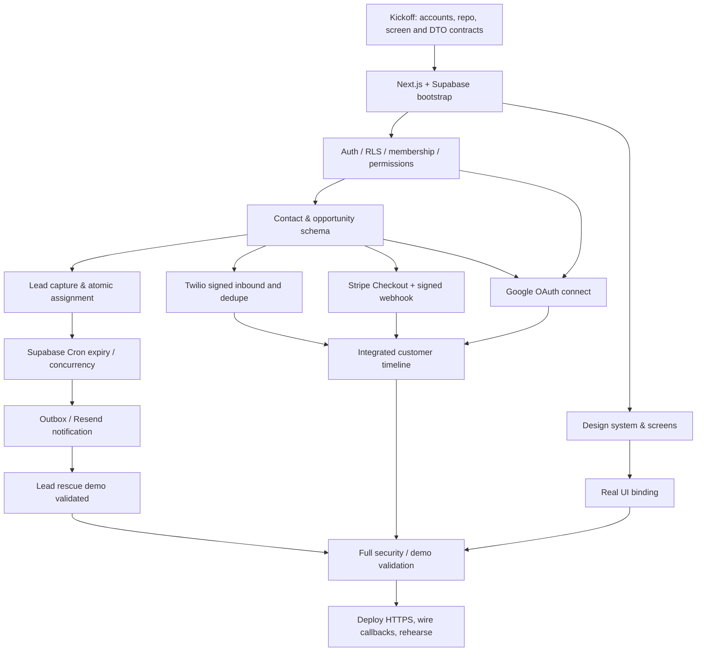

# Critical Path — Dependencies, Earliest Validation and Blocking Risks

The solution is only as good as its durable lead flow. **UI work can run early and in parallel; it cannot replace the dependencies of lead ownership and real integrations.**

## Absolute blockers (cannot safely parallel within dependent chain)
- Auth identity + membership **before** testing tenant-scoped writes and permissions.
- Contact record + SQL version/fk contracts **before** lead intake / opportunity-dependent integrations.
- Exactly-one-owner assignment **before** timer-driven escalation; Cron *after* persisted deadline and transition versions.
- Verified provider endpoint setup **before** claiming Twilio/Stripe webhook completion.
- Google OAuth **before** FreeBusy/event lifecycle.
- Server-created Stripe Checkout **before** webhooks can match paid transactions and dashboard revenue.
- Signed event processing + complete data **before** genuine metrics and judge proof.
- All modules merged **before** deployment smoke and final integrated rehearsal.

## High-risk unknowns to resolve before first commit
1. Supabase project capabilities and Cron cadence/reliability observed on chosen plan (do not assume exact seconds).
2. Twilio sandbox phone enrollment, callback public HTTPS, geographic/channel availability.
3. Stripe test account, live webhook delivery, test checkout and refund event coverage.
4. Google OAuth publishing/testing user restrictions and refresh token handling.
5. Resend sender verification and receipt by chosen employee address.
6. Whether RLS policies + role-specific confidential financial column access cover Data API/direct route/export.

## Fastest meaningful milestones
**M1 secure spine:** two workspaces, forbidden direct read, manual lead -> one owner -> acknowledgement -> audit.
**M2 differentiator:** no acknowledgement -> Cron automatically reassigns -> real outside email + recovery; crash/concurrency test.
**M3 connected:** real WhatsApp inbound/outbound, Stripe verified checkout/refund, Google appointment.
**M4 premium demo:** polished mobile and desktop, integrated timeline, role-aware metrics, synced and failed states.
**M5 release:** deployment, negative security case, recorded proof, final presentation.

## Quality gate prioritization
A failing isolation or wrong-owner bug blocks release even if all UI screens are perfect. A simulated external event cannot satisfy a provider requirement. Visual quality gates run **alongside** core engineering gates so late visual rework does not endanger the launch.
